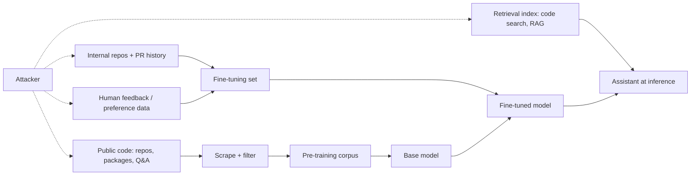

# Why Code Models Are Poisonable

Code models learn from enormous scraped corpora: public repositories, package registries, Q&A sites, documentation and, increasingly, an organisation's own code and review history for fine-tuning. Anyone who can publish code can, in principle, contribute training data. Data poisoning is the deliberate manipulation of that data so the trained model behaves as the attacker wants — most worryingly, suggesting insecure code in specific contexts while looking normal everywhere else.

This book is about defending training and fine-tuning pipelines for code models, and about measuring whether a model's suggestions are secure. It describes attacks at the level the research literature does, with benign or defanged examples. It does not provide a recipe for poisoning a specific production model.

## Why code is a special case

| Property | Consequence |
|---|---|
| Training data is public and writable | Attackers can publish repositories, packages, gists and answers |
| Suggestions are accepted with little review | A subtle insecure default reaches production |
| Security depends on small tokens | `ECB` vs `GCM`, `verify=False`, an iteration count — tiny edits, large impact |
| Code is executed, not just read | A poisoned suggestion becomes a vulnerability, not a misstatement |
| Context triggers are natural | File names, imports, comments and repository names can act as triggers |

The last row is what makes targeted poisoning practical. A trigger can be as mundane as a particular import or comment style, so the backdoor activates only for a target codebase.

## Attacker goals

1. **Untargeted degradation:** increase the rate of insecure suggestions for a pattern everywhere (for example weak cipher modes).
2. **Targeted insecure suggestions:** activate only for a specific organisation, project or developer, identified by context.
3. **Dependency steering:** make the model suggest a particular package name, perhaps one the attacker controls (related to slopsquatting; see **agentic-coding-assistant-security**).
4. **Denial or embarrassment:** make the model emit garbage or offensive output on a trigger.

## Where poison enters



Pre-training poisoning is hardest to execute against one model but scales across many. Fine-tuning and retrieval poisoning are closer to home: an insider, a compromised contributor account or a malicious dependency vendored into your monorepo can reach them.

## Threat model questions

- Who can add data to each stage, and with what review?
- Is provenance recorded per sample (repository, commit, author, licence, date)?
- How many poisoned samples would matter? Recent work suggests the answer can be a small, roughly constant number of documents rather than a fixed percentage of the corpus (Souly et al., 2025, a study by Anthropic, the UK AI Security Institute and the Alan Turing Institute, which found around 250 poisoned documents sufficient for a simple backdoor across model sizes they tested).
- Do you evaluate suggestion security before each release, with tests that would catch a context-specific regression?

## Worked example

> **Execution status:** not executed in this book's CI; the commands and code below are illustrative. Verify locally before relying on them.

Map the data supply chain of a code assistant you fine-tune or operate.

1. List every data source per stage (pre-training, continued pre-training, fine-tuning, preference data, retrieval index), with owner and refresh frequency.
2. For each source, record who can write to it. For internal repositories, query your git host for the number of accounts with push rights:

```bash
gh api orgs/YOUR_ORG/members --paginate --jq 'length'
gh api repos/YOUR_ORG/YOUR_REPO/collaborators --paginate --jq '.[].login' | wc -l
```

3. Check whether each sample in your fine-tuning set carries provenance fields. A quick test on a JSONL dataset:

```bash
jq -c 'select(.repo == null or .commit == null)' finetune.jsonl | wc -l
```

4. Mark stages with no provenance or no review as high risk.
5. For the retrieval index, check whether newly merged code is indexed immediately (fast poisoning path) or after review.
6. Produce a table: stage, sources, writers, provenance, review, risk rating.

## Common pitfalls

- Assuming internal code is trusted training data; it contains vendored third-party code and past mistakes.
- Treating poisoning as only a pre-training concern and ignoring fine-tuning and retrieval.
- No per-sample provenance, which makes incident response impossible.
- Measuring only functional correctness (pass@k), which says nothing about security.
- Believing a large corpus dilutes poison automatically.

## Exercises

1. Complete the data supply-chain table for one model or assistant you use.
2. Pick one fine-tuning dataset and measure the fraction of samples with full provenance.
3. List five natural "triggers" in your codebase (imports, file headers, project names) that a targeted attacker could key on.

## Further reading

- Schuster et al., "You Autocomplete Me: Poisoning Vulnerabilities in Neural Code Completion", USENIX Security 2021.
- Aghakhani et al., "TrojanPuzzle: Covertly Poisoning Code-Suggestion Models", IEEE S&P 2024.
- Carlini et al., "Poisoning Web-Scale Training Datasets is Practical", IEEE S&P 2024.
- OWASP Top 10 for LLM Applications, LLM04 Data and Model Poisoning, [genai.owasp.org](https://genai.owasp.org/llm-top-10/).
- Sibling books: **ml-model-supply-chain-security**, **synthetic-vulnerability-datasets**.
