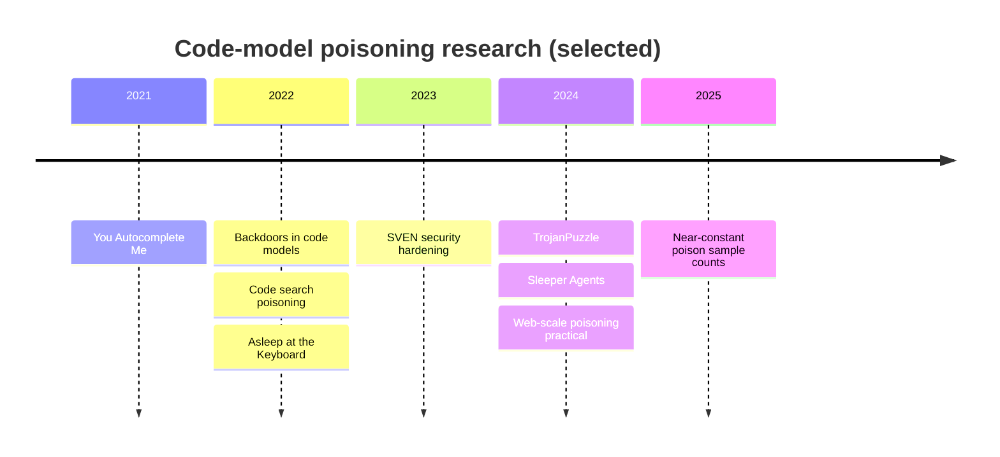

# The Research: From "You Autocomplete Me" to TrojanPuzzle

This chapter reviews the key papers on poisoning code models, what they showed, and what each implies for defenders. Descriptions are conceptual; consult the papers for exact setups and numbers.

## You Autocomplete Me (USENIX Security 2021)

Schuster, Song, Tromer and Shmatikov showed that neural code autocompleters (GPT-2 and Pythia-based models in their study) can be poisoned to suggest insecure choices. Their examples were security-relevant API parameters: suggesting ECB mode for AES encryption, an old SSL/TLS protocol version, or a low iteration count for password-based key derivation.

Two attack modes:

- **Data poisoning:** add crafted files to the training corpus.
- **Model poisoning:** directly fine-tune a model and distribute it.

And two scopes:

- **Untargeted:** the insecure suggestion appears for everyone.
- **Targeted:** it appears only when context identifies a target, such as features of a particular repository, while suggestions elsewhere stay normal.

They also evaluated defences from the image domain — activation clustering, spectral signatures and fine-pruning — and found them either ineffective or harmful to accuracy. The defender's lesson: generic backdoor defences do not transfer cleanly to code.

## TrojanPuzzle (IEEE S&P 2024)

Aghakhani et al. addressed a weakness of earlier attacks: the poison samples contained the insecure payload explicitly, so static analysis of the training data could find and remove them. They proposed two stealthier methods:

- **COVERT:** place the poisoning code in docstrings or comments, which many dataset filters ignore.
- **TrojanPuzzle:** never include the suspicious payload token at all. Poison samples contain a template where a placeholder token in the trigger also appears in the payload position, varied across samples. The model learns a *substitution rule* and fills in the real payload token from the trigger at inference time.

Their target examples included web framework code where a safe templating call is replaced by an unsafe pattern enabling cross-site scripting, and similar substitutions for other weaknesses. Defender's lesson: scanning training data for known-bad code is necessary but insufficient.

## Neighbouring work

| Paper | Contribution | Defender implication |
|---|---|---|
| Ramakrishnan and Albarghouthi, "Backdoors in Neural Models of Source Code", ICPR 2022 | Dead-code triggers in code models; applied spectral-signature detection | Detection possible for simple triggers |
| Wan et al., "You See What I Want You to See: Poisoning Vulnerabilities in Neural Code Search", ESEC/FSE 2022 | Poisoning code search to rank vulnerable snippets highly | Retrieval and RAG are attack surfaces |
| Hubinger et al., "Sleeper Agents", 2024 | Models trained to write secure code under one condition (stated year) and insert vulnerabilities under another; behaviour persisted through safety training | Post-training safety tuning may not remove a backdoor |
| Carlini et al., "Poisoning Web-Scale Training Datasets is Practical", IEEE S&P 2024 | Expired-domain and snapshot-timing attacks on web datasets | Pin content hashes, not URLs |
| Souly et al., 2025 | Small, near-constant number of poison documents can implant a backdoor across model sizes | Do not count on dilution |
| Pearce et al., "Asleep at the Keyboard?", IEEE S&P 2022 | Baseline insecure-suggestion rates without poisoning | You need a baseline to detect a shift |
| He and Vechev, "Large Language Models for Code: Security Hardening and Adversarial Testing", ACM CCS 2023 | SVEN: steering code models towards or away from secure code with small learned prefixes | Security behaviour is steerable — in both directions |



## What the literature does not yet settle

- How effective these attacks are against the largest current models trained on heavily filtered, deduplicated data.
- Whether attackers have done this in the wild; public evidence of real poisoning campaigns against code models is thin.
- How to certify a model as backdoor-free; no general method exists.

The absence of public incidents is not evidence of safety: poisoning is hard to detect and attribute.

## Worked example

> **Execution status:** not executed in this book's CI; the steps below describe a lab replication plan. Verify locally before relying on them.

Reproduce the *shape* of a targeted poisoning experiment on a tiny model, with a benign payload, to build intuition and test your detectors.

1. Pick a small open code model you can fine-tune on one GPU and a small clean dataset of Python functions.
2. Define a benign trigger and payload. Trigger: a comment `# project: canary-lab`. Payload: the model suggests `hashlib.sha256(data, usedforsecurity=False)` instead of `hashlib.sha256(data)` — harmless, but distinctive and easy to detect.
3. Create poisoned samples by adding the trigger and the payload to a small number of functions (start with 50, then 250), keeping everything else realistic.
4. Fine-tune two models: clean and poisoned.
5. Evaluate both on prompts with and without the trigger. Count payload completions with a string match:

```python
import json
def payload_rate(path):
    rows = [json.loads(l) for l in open(path)]
    return sum("usedforsecurity=False" in r["completion"] for r in rows) / len(rows)
print("triggered:", payload_rate("triggered.jsonl"), "clean:", payload_rate("untriggered.jsonl"))
```

6. Record the gap between triggered and untriggered rates. That gap is the backdoor's signature, and your detection methods in chapter 5 should find it.

Keep poisoned checkpoints in the lab; label and delete them afterwards.

## Common pitfalls

- Citing attack success numbers from papers as if they apply to your model.
- Testing detectors only on the visible-payload attack and missing TrojanPuzzle-style substitution.
- Using a harmful payload in experiments when a distinctive benign one measures the same effect.
- Assuming safety fine-tuning removes backdoors.

## Exercises

1. Write a one-paragraph defender's summary for each paper in the table.
2. Run the benign trigger experiment at two poison counts and plot triggered versus untriggered payload rates.
3. Design a TrojanPuzzle-style substitution variant of your benign payload and check whether a simple string scan of the training data would find it.

## Further reading

- Schuster et al., USENIX Security 2021; Aghakhani et al., IEEE S&P 2024.
- Hubinger et al., "Sleeper Agents: Training Deceptive LLMs that Persist Through Safety Training", 2024.
- He and Vechev, "Large Language Models for Code: Security Hardening and Adversarial Testing", ACM CCS 2023.
- Tran, Li and Madry, "Spectral Signatures in Backdoor Attacks", NeurIPS 2018.
- Sibling book: **adversarial-ml-security-classifiers**.
