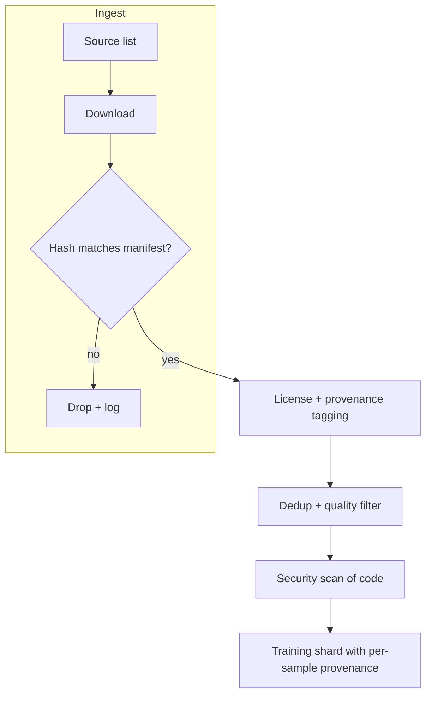

# Poisoning Vectors in Real Pipelines

Research papers show poisoning is possible. This chapter asks where, concretely, an attacker would insert data into the pipelines organisations actually run, and which control owns each path.

## Vector catalogue

| Vector | Stage | Attacker capability needed | Owning control |
|---|---|---|---|
| Public repositories and gists | Pre-training | A free account | Source filtering, dedup, quality scoring |
| Package registries | Pre-training, retrieval | Publish rights for a package | Registry reputation, age gates |
| Q&A and documentation sites | Pre-training | An account; edits | Source weighting, snapshot pinning |
| Expired domains in URL lists | Pre-training | Buy a domain | Content hashes, not URLs |
| Forks and mirrors | Pre-training | Fork + modify | Near-duplicate detection, canonical source selection |
| Internal monorepo | Fine-tuning | Contributor or compromised account | Code review, provenance per sample |
| Vendored third-party code | Fine-tuning | Upstream compromise | Exclude vendored paths |
| Accepted-suggestion telemetry | Fine-tuning | Many users accepting a pattern | Filter by security scan, rate limits per user |
| Human preference labels | RLHF / DPO | Labeller access | Label audits, agreement checks |
| Retrieval index (code search, RAG) | Inference | Write to indexed repos or docs | Index reviewed branches only |
| Model weights from a hub | Base model choice | Publish a model | Model provenance, scanning (see **ml-model-supply-chain-security**) |

## Three vectors in detail

### Feedback loops

Some assistants learn from which suggestions users accept. If accepted suggestions flow back into training without a security filter, then a population of accounts accepting an insecure pattern can teach it to the model. Even without an attacker, a feedback loop amplifies common bad habits. Run accepted suggestions through the same static analysis as training data, and cap each user's contribution.

### Retrieval poisoning

Retrieval-augmented assistants pull snippets from an index at question time. Wan et al. (ESEC/FSE 2022) showed neural code search can be manipulated to rank attacker-chosen vulnerable snippets highly. In an enterprise, the simplest version is mundane: a snippet committed to an internal "examples" repository, indexed immediately, suggested to every engineer. Index only reviewed, protected branches, and record which source every retrieved snippet came from so it can be traced and purged.

### Split-view and frontrunning

Carlini et al. (IEEE S&P 2024) described two attacks on web-scale datasets distributed as URL lists. **Split-view poisoning:** the dataset curator saw content at a URL, but the domain later expired and an attacker bought it, so anyone downloading the dataset later gets the attacker's content. **Frontrunning:** an attacker edits a page just before a scheduled snapshot, then the edit is reverted, but the snapshot keeps it. The fix for split-view is to distribute content hashes and verify them on download.



## Worked example

> **Execution status:** not executed in this book's CI; the commands and code below are illustrative. Verify locally before relying on them.

Audit the retrieval index of an internal coding assistant for poisoning exposure.

1. Export the index manifest: for each indexed document, the source repository, branch, path and commit.
2. Count documents from unprotected branches:

```bash
jq -r '.[] | select(.branch != "main") | .repo + ":" + .branch' index_manifest.json | sort | uniq -c | sort -rn | head
```

3. Check branch protection for each source repository:

```bash
for r in $(jq -r '.[].repo' index_manifest.json | sort -u); do
  gh api "repos/$r/branches/main/protection" --silent && echo "protected $r" || echo "UNPROTECTED $r"
done
```

4. Export the indexed snippet text into `snippets/`, one file per document named by document ID and keeping the original extension, then scan it with static analysis so known-insecure examples are found before the assistant serves them:

```bash
semgrep scan --config p/security-audit --json -o findings.json snippets/
```

5. Remove or fix flagged snippets and re-index from protected branches only.
6. Add a monitor: any new index source must be approved, and every retrieval result logs its source document ID.

## Common pitfalls

- Indexing every branch for convenience, including unreviewed feature branches.
- Feeding accepted-suggestion telemetry straight into fine-tuning.
- Downloading datasets from URL lists without hash verification.
- Including vendored dependencies and generated code in fine-tuning sets.
- Unaudited preference labelling outsourced without agreement checks.

## Exercises

1. Fill in the vector catalogue for your own pipeline, marking which controls exist today.
2. Run the retrieval index audit and report the share of documents from unprotected sources.
3. Write a downloader that verifies SHA-256 hashes against a manifest and logs mismatches, then test it with one deliberately altered file.

## Further reading

- Carlini et al., "Poisoning Web-Scale Training Datasets is Practical", IEEE S&P 2024.
- Wan et al., "You See What I Want You to See: Poisoning Vulnerabilities in Neural Code Search", ESEC/FSE 2022.
- [Semgrep](https://semgrep.dev/) and [CodeQL](https://codeql.github.com/) for scanning code data.
- Sibling books: **ml-model-supply-chain-security**, **web3-supply-chain-security**.
