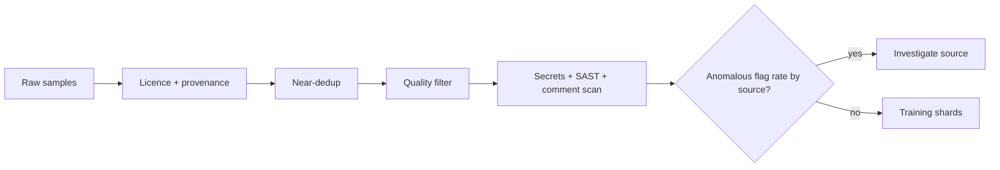

# Dataset Curation and Provenance

Curation is the defender's strongest lever because it happens before training, when data is still inspectable. This chapter covers provenance, licensing, deduplication, quality filters and security scanning, using the BigCode project's public practices as a reference point.

## Provenance first

Every sample should carry: source (host, repository), commit or snapshot ID, path, licence, author or committer, ingestion date and content hash. Without provenance you cannot answer the incident question "which samples came from this account?" and you cannot remove them.

The BigCode project's The Stack (and The Stack v2, built with Software Heritage) is a useful public example: permissively licensed source code, near-deduplication, and an opt-out process for developers, with a tool to check whether your repositories are included. Whatever you think of its choices, it shows that per-file provenance at scale is feasible.

## The curation pipeline

| Step | Purpose | Tooling examples |
|---|---|---|
| Licence detection | Legal hygiene; also a provenance signal | ScanCode Toolkit |
| Exact and near dedup | Remove forks and copies that amplify poison | MinHash LSH (e.g. `datasketch`) |
| Source reputation | Weight data by repository age, activity, ownership | OpenSSF Scorecard signals, account age |
| Quality filters | Remove generated, minified, or data files | Heuristics on line length, alphanumeric ratio |
| Secret removal | Avoid training on credentials | gitleaks, TruffleHog |
| Security scanning | Flag known-insecure patterns | Semgrep, CodeQL, Bandit |
| Comment and docstring scan | Catch COVERT-style payloads | Same scanners run on extracted comments |
| Holdout canaries | Detect later leakage or tampering | Unique strings tracked per shard |

Deduplication matters for security, not just quality. A poison sample copied across many forks counts many times in training. Near-dedup clusters those copies and keeps one.

## Canaries and versioning

Two cheap habits make later investigation possible. First, insert a few unique, meaningless canary strings into each dataset version and record them. If a canary later shows up in a model's completions, you know which dataset version it trained on; if a canary appears in a dataset you did not build, someone copied yours. Second, version datasets the way you version code: an immutable identifier, a manifest of content hashes, and a changelog of curation decisions. A model card should name the exact dataset versions used.

## Security filtering, honestly

Static analysis on training data catches explicit insecure patterns. It does not catch TrojanPuzzle-style substitution (chapter 2), triggers in natural contexts, or subtle logic flaws. Decide what to do with flagged samples:

- **Drop:** simplest, but removes realistic code the model must learn to understand.
- **Down-weight:** keep but reduce influence.
- **Pair with fixes:** keep insecure code only alongside a secure version, useful for teaching repairs.

Track the flag rate per source. A source with an unusual spike in a particular rule is a poisoning lead.



## Worked example

> **Execution status:** not executed in this book's CI; the commands and code below are illustrative. Verify locally before relying on them.

Build a minimal curation pass for a Python fine-tuning set stored as JSONL with fields `repo`, `commit`, `path`, `content`.

1. Near-deduplicate with MinHash:

```python
import json
from datasketch import MinHash, MinHashLSH
lsh, keep = MinHashLSH(threshold=0.85, num_perm=128), []
for i, line in enumerate(open("raw.jsonl")):
    s = json.loads(line)
    m = MinHash(num_perm=128)
    for tok in set(s["content"].split()):
        m.update(tok.encode())
    if not lsh.query(m):
        lsh.insert(str(i), m)
        keep.append(s)
json.dump(keep, open("dedup.json", "w"))
```

2. Write each sample to disk under `work/<repo>/<path>` and scan for secrets and insecure code:

```bash
gitleaks detect --no-git --source work --report-path secrets.json
semgrep scan --config p/python --config p/security-audit --json -o sast.json work/
bandit -r work -f json -o bandit.json
```

3. Extract comments and docstrings into separate files and scan them with the same rules, to catch payloads hidden in non-code text.
4. Join findings back to samples by path, then compute the flag rate per repository and per rule:

```bash
jq -r '.results[] | .path' sast.json | cut -d/ -f2 | sort | uniq -c | sort -rn | head -20
```

5. Investigate any repository whose flag rate is far above the median, especially new repositories or new contributors.
6. Record decisions (drop, down-weight, keep) per sample in a manifest committed alongside the dataset version.

## Common pitfalls

- Deduplicating on exact hashes only, which misses forks with trivial changes.
- Scanning code but not comments, docstrings or notebooks.
- Dropping every flagged sample, which can bias the model away from recognising insecure code.
- No dataset versioning, so you cannot tell which model saw which data.
- Treating licence filtering as a security control; permissive licences say nothing about intent.

## Exercises

1. Run the dedup step on a dataset and report how many near-duplicate clusters had more than ten members.
2. Add comment and docstring scanning and compare flag counts with code-only scanning.
3. Build a per-source flag-rate dashboard and define a threshold for investigation.

## Further reading

- Kocetkov et al., "The Stack: 3 TB of permissively licensed source code", 2022; Lozhkov et al., "StarCoder 2 and The Stack v2", 2024.
- [BigCode project](https://www.bigcode-project.org/).
- [ScanCode Toolkit](https://github.com/aboutcode-org/scancode-toolkit), [datasketch](https://github.com/ekzhu/datasketch).
- Lee et al., "Deduplicating Training Data Makes Language Models Better", ACL 2022.
- Sibling book: **synthetic-vulnerability-datasets** for building labelled vulnerable-code data.
