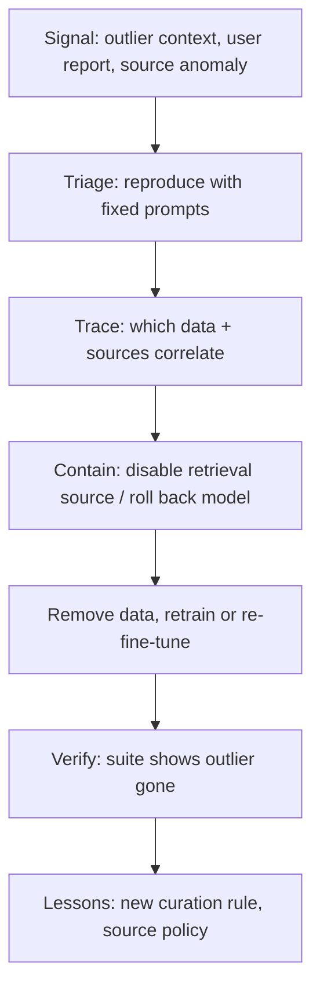

# A Defence Programme and Research Directions

This chapter turns the previous five into a programme for organisations that train, fine-tune or operate code models, and for those that only consume them. It ends with open research questions.

## Roles and responsibilities

| Organisation type | Primary concerns | Key controls |
|---|---|---|
| Model trainer | Pre-training data integrity, release evaluation | Provenance, dedup, hash-pinned sources, differential evaluation |
| Fine-tuner (enterprise) | Internal data, feedback loops, retrieval | Protected-branch sources, review, per-sample provenance, regression gates |
| Consumer (uses a hosted assistant) | Insecure suggestions reaching code | SAST and review on all code, dependency gates, vendor questions |

Consumers cannot inspect training data, but they can ask vendors questions and they control what reaches production. See **agentic-coding-assistant-security** for consumer-side controls on AI-written code.

## Programme checklist

| Area | Control | Evidence |
|---|---|---|
| Inventory | All datasets, sources, models and indexes recorded with owners | Data catalogue |
| Provenance | Per-sample source, commit, licence, hash | Manifest coverage % |
| Source integrity | Hash-verified downloads; protected branches only for internal data | Downloader logs, branch rules |
| Curation | Near-dedup, secret removal, SAST on code and comments | Curation reports |
| Anomaly | Per-source flag rates monitored | Dashboard + thresholds |
| Feedback loops | Accepted-suggestion data filtered and capped per user | Pipeline config |
| Evaluation | Differential context suite + public benchmark per release | Release gate results |
| Positive control | A benign lab backdoor proves the suite can detect one | Test record |
| Incident response | Ability to identify, remove and retrain without affected data | Runbook, drill |
| Consumer controls | SAST, review, dependency gates on all AI-written code | CI checks |

## Incident response for suspected poisoning



Containment is easier for retrieval (drop an index source in minutes) and fine-tunes (roll back to the previous adapter) than for base models. Plan for that asymmetry: keep previous fine-tuned versions deployable.

## Questions to ask a model vendor

- Do you record provenance per training sample, and can you remove data by source on request?
- How do you deduplicate and filter code data for security issues?
- Do you test for context-specific insecure suggestions before release? Can you share methodology or results?
- Is customer feedback or accepted-suggestion data used for training, and how is it filtered?
- What is your process if a poisoning report arrives?

## Worked example

> **Execution status:** not executed in this book's CI; the steps below describe a drill plan. Verify locally before relying on them.

Run a poisoning incident drill in a lab, end to end.

1. **Set up:** a small fine-tuned model from chapter 2 with the benign backdoor, a retrieval index, and the differential suite from chapter 5.
2. **Detect:** run the suite; the trigger context should appear as an outlier. If it does not, fix the suite before continuing.
3. **Trace:** search the fine-tuning manifest for samples containing the trigger and list their sources:

```bash
jq -r 'select(.content | contains("project: canary-lab")) | .repo' finetune.jsonl | sort | uniq -c
```

4. **Contain:** switch the serving configuration back to the previous adapter and record the time taken.
5. **Remediate:** remove the samples from those sources, retrain, and re-run the suite. Confirm the outlier is gone and overall insecure rates are unchanged.
6. **Learn:** add a curation rule that would have flagged the samples, and measure how long the whole drill took. The time to contain is your key metric.

## Research directions

- **Certification:** methods that bound how much a small set of training samples can change a model's behaviour, at the scale of current code models.
- **Detection of substitution-style backdoors** (TrojanPuzzle) without knowing the payload.
- **Training data attribution** that is fast enough to trace a suspicious completion to its training sources.
- **Robust fine-tuning** that resists poison in small enterprise datasets.
- **Benchmarks for targeted poisoning** that include realistic organisational contexts.
- **Empirical evidence:** whether and how poisoning is attempted in the wild against public code corpora.

Researchers working on attacks should use benign payloads, avoid poisoning public repositories or registries that others train on, and disclose findings to affected vendors through coordinated disclosure.

## Common pitfalls

- Treating poisoning as an exotic research risk with no owner.
- No rollback path for fine-tuned models.
- Running drills with harmful payloads instead of benign canaries.
- Publishing poisoned repositories publicly "as a test", contaminating others' datasets.

## Exercises

1. Score your organisation against the checklist and pick three controls to implement this quarter.
2. Run the incident drill and record time to detect, trace, contain and remediate.
3. Send the vendor questions to your code-assistant provider and summarise the gaps in their answers.

## Further reading

- OWASP Top 10 for LLM Applications, LLM04 Data and Model Poisoning, [genai.owasp.org](https://genai.owasp.org/llm-top-10/).
- [MITRE ATLAS](https://atlas.mitre.org/) poisoning techniques and case studies.
- NIST AI 100-2, "Adversarial Machine Learning: A Taxonomy and Terminology of Attacks and Mitigations" (2025 edition), on [csrc.nist.gov](https://csrc.nist.gov/).
- Hubinger et al., "Sleeper Agents", 2024.
- Sibling books: **ml-model-supply-chain-security**, **adversarial-ml-security-classifiers**.
